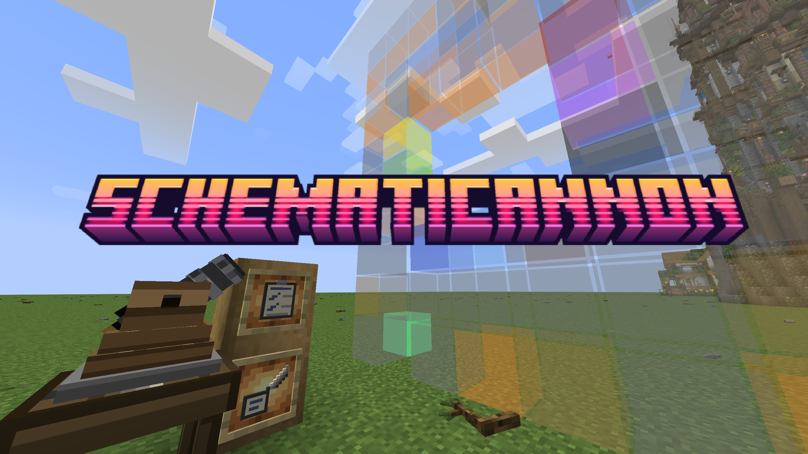
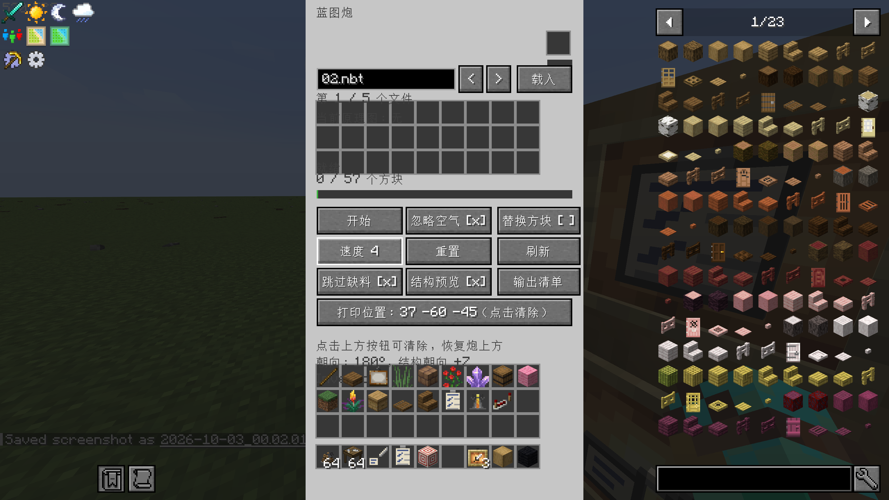
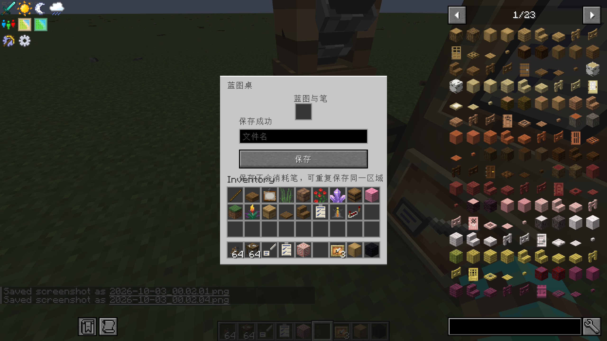
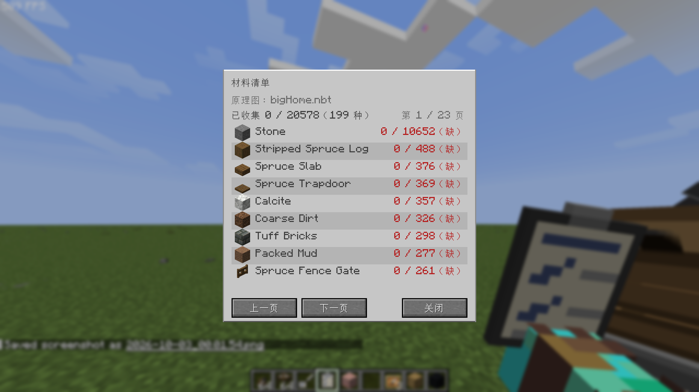

# Simple Schematicannon (schematicannon)

> A mod that ports a simplified version of Create's Schematicannon, built for NeoForge 1.26.1.2.

> **This project contains AI-generated code.**

## Screenshots

